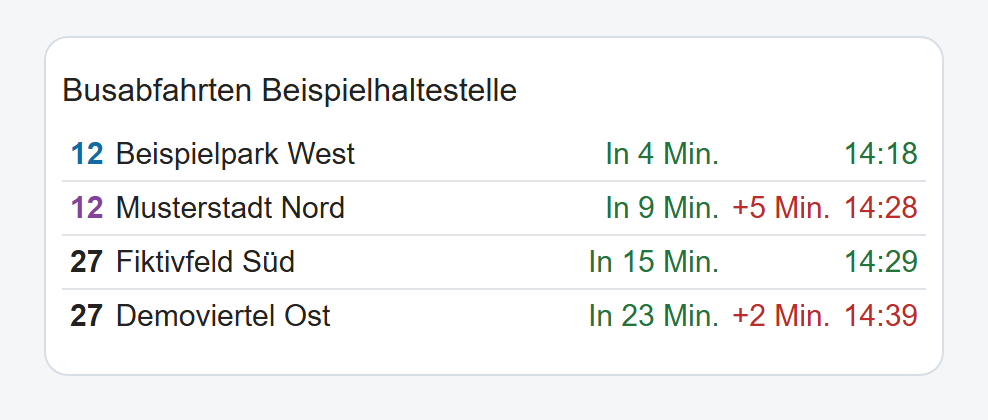

# VBN-Abfahrten in Home Assistant

Zeige die nächsten Abfahrten einer Haltestelle im Home-Assistant-Dashboard. Die Karte stellt Fahrplanzeit, Verspätung und voraussichtliche Abfahrtszeit nebeneinander dar. Auf schmalen Karten können Zielnamen auf zwei Zeilen stehen.



Das Projekt enthält eine angepasste GTFS2-Integration auf Basis des [Releases 0.5.9.10](https://github.com/vingerha/gtfs2/releases/tag/0.5.9.10) und die [Dashboard-Karte](departures-gtfs2.js). GTFS2 lädt die Fahrpläne und Echtzeitdaten. Die Karte liest die Abfahrten aus den Sensoren von Home Assistant. Die Anleitung verwendet VBN-Daten. Alle Haltestellen und Fahrten im Beispiel sind erfunden.

## 1. Die Integration installieren

1. Lade das Projekt von GitHub über **Code → Download ZIP** herunter und entpacke es auf deinem Computer.
2. Öffne deinen Home-Assistant-Konfigurationsordner, zum Beispiel über die App **Samba share**. In Windows erreichst du die Freigabe mit `\\<Home-Assistant-IP>\config`. Dort liegt auch deine `configuration.yaml`. [Home Assistant zum Dateizugriff](https://www.home-assistant.io/common-tasks/os/#installing-and-using-the-samba-share-app)
3. Kopiere aus dem entpackten Projekt den ganzen Ordner `custom_components/gtfs2` in den gleichnamigen Pfad deiner Home-Assistant-Konfiguration. Das Ergebnis sollte `/config/custom_components/gtfs2/manifest.json` sein.
4. Starte Home Assistant neu.

Wenn du GTFS2 bereits installiert hast, sichere zuerst den bisherigen Ordner `custom_components/gtfs2` außerhalb von `custom_components` und ersetze dann den Ordner durch diese Version. Die vorhandenen GTFS2-Einträge bleiben in Home Assistant gespeichert. Ein Update der Originalintegration über HACS kann die angepassten Dateien wieder überschreiben. Um zur vorherigen Installation zurückzukehren, stelle den gesicherten Ordner wieder her und starte Home Assistant neu.

## 2. Den VBN-Fahrplan importieren

1. Melde dich im **Connect-OpenData-Portal** an oder registriere dich dort. Aktiviere das GTFS-Fahrplanpaket für Bremen und Niedersachsen, das zum VBN-Echtzeitfeed passt, und lade die ZIP-Datei herunter. Je nach Paket ist der Download sofort verfügbar oder Connect benachrichtigt dich nach der Freischaltung. [Connect-OpenData-Portal](https://www.connect-info.net/opendata/) · [Connect zur Datenbereitstellung](https://connect-fahrplanauskunft.de/datenbereitstellung/)
2. Lege im Home-Assistant-Konfigurationsordner einen Ordner `gtfs2` an. Kopiere die ZIP-Datei unentpackt als `/config/gtfs2/vbn.zip` hinein.
3. Öffne **Einstellungen → Geräte & Dienste → Integration hinzufügen**. Suche nach **GTFS 2** und wähle **Eine neue Datenquelle einrichten**.
4. Wähle unter **Daten extrahieren von** die Option **ZIP**. Gib bei **Neuer Name der Datenquelle** den Namen `vbn` ohne Dateiendung ein. Belasse beim URL-Feld den vorbelegten Wert `na` und bestätige. [GTFS2 zur Einrichtung einer Datenquelle](https://github.com/vingerha/gtfs2/wiki)
5. Die Meldung **„Es werden (noch) Daten extrahiert“** schließt beim Erstimport den Dialog. GTFS2 liest die Fahrplandaten im Hintergrund ein und legt dafür `vbn.sqlite` an. Lass Home Assistant weiterlaufen und plane ausreichend Platz für die Datenbank ein. Fahre danach mit **Schritt 3** fort. Falls dort erneut die Extraktionsmeldung erscheint, warte und versuche Schritt 3 später noch einmal.

## 3. Haltestelle und Echtzeit einrichten

1. Öffne **Einstellungen → Bereiche, Labels & Zonen → Zonen** und lege eine Zone an der echten Haltestelle an, die du anzeigen möchtest. Wenn du beide Fahrtrichtungen brauchst, setze den Mittelpunkt zwischen die Haltepositionen. Merk dir die Zonen-ID, hier als Beispiel `zone.beispielhaltestelle`. [Home Assistant zum Anlegen von Zonen](https://www.home-assistant.io/integrations/zone/#adding-a-new-zone-or-editing-zones)
2. Wähle erneut **GTFS 2** unter **Integration hinzufügen** und dann **Geplante Abfahrt an Haltestellen in Ihrer Nähe**. Wähle die Quelle `vbn`, als **Objekt/Person zur Verwendung für Lat/Lon** deine Zone und als Namen zum Beispiel **Beispielhaltestelle**.
3. Öffne bei diesem GTFS2-Eintrag **Konfigurieren**. Stelle den **Radius für die Suche nach Haltestellen** so ein, dass GTFS2 die gewünschten Haltepositionen findet. Ein größerer Radius kann zusätzliche Haltestellen einschließen. Setze die **Prüfung auf zukünftige Abfahrten** zum Beispiel auf 60 Minuten.
4. Aktiviere **Echtzeitintegration einrichten**. Trage bei **URL zu Reisedaten** `https://gtfsr.vbn.de/gtfsr_connect.bin` ein. Das ist der öffentliche Protobuf-Feed des VBN. Das API-Schlüsselfeld bleibt für diesen Feed leer. [VBN zum Echtzeitfeed und seiner Lizenz](https://www.vbn.de/service/entwicklerinfos/open-data-und-open-service/)
5. Prüfe unter **Entwicklerwerkzeuge → Zustände** einen neu angelegten GTFS2-Haltestellensensor. Sobald Abfahrten vorliegen, enthält sein Attribut `next_departures_lines` eine Liste. Findest du keine Sensoren, prüfe den Zonenmittelpunkt, den Suchradius und ob der Fahrplanimport abgeschlossen ist.

Der VBN liefert Echtzeitdaten für einen Teil der Fahrten. In `next_departures_lines` steht bei jeder Abfahrt unter `realtime_source`, welche Daten vorliegen. `direct` steht für eine direkte Haltmeldung, `estimated` für eine aus einem früheren Halt derselben Fahrt fortgeschriebene Verspätung und `none` für die Fahrplanzeit ohne Echtzeitmeldung. Wenn alle Abfahrten dauerhaft `none` zeigen, prüfe die Feed-URL und ob der Connect-Fahrplan noch aktuell ist.

## 4. Dashboard-Karte installieren

1. Kopiere `departures-gtfs2.js` aus dem entpackten Projekt nach `/config/www/departures-gtfs2.js`. Wenn du den Ordner `www` neu angelegt hast, starte Home Assistant einmal neu.
2. Öffne **Einstellungen → Dashboards** und wähle im Menü oben rechts **Ressourcen**. Füge `/local/departures-gtfs2.js?v=14` als **JavaScript-Modul** hinzu.
3. Lade das Dashboard neu. Erhöhe bei einem späteren Dateiupdate die Zahl hinter `?v=`, damit der Browser die aktualisierte Datei lädt. [Home Assistant zu Dashboard-Ressourcen](https://contributors.home-assistant.io/frontend/custom-ui/resources/)

## 5. Karte hinzufügen

Öffne dein Dashboard und wähle **Dashboard bearbeiten → Karte hinzufügen → GTFS2 Abfahrten**. Gib einen Kartentitel ein, wähle deine **Haltestellenzone** und aktiviere **Minuten bis zur geplanten Abfahrt anzeigen**, wenn du einen Countdown möchtest. Die Karte findet die GTFS2-Sensoren zur Zone automatisch. Unter **Farben nach Linie und Ziel** kannst du dieselbe Linie je nach Fahrtziel unterschiedlich einfärben.

Alternativ wähle beim Hinzufügen **Manuell** und kopiere dieses Beispiel. Ersetze Titel und Zonen-ID durch deine eigenen Werte.

```yaml
type: custom:departures-gtfs2
title: Busabfahrten Beispielhaltestelle
local_stop_zone: zone.beispielhaltestelle
displayed_connections: 8
relativeTime: true
limit: 30
hide_past_departures: true
```

Für jede weitere Haltestelle wiederholst du Schritt 3 und legst eine weitere Karte mit der passenden Zonen-ID an. Den VBN-Fahrplan und die Kartendatei kannst du dabei erneut verwenden.

## Herkunft und Lizenzen

- Die Integration basiert auf [GTFS2 von vingerha](https://github.com/vingerha/gtfs2) und steht unter der [MIT-Lizenz](LICENSE-GTFS2). Die Änderungen zur Echtzeitfortschreibung liegen in `gtfs_helper.py` und `gtfs_rt_helper.py`. Der Paketstand in `manifest.json` lautet `0.5.9.10`.
- Die Dashboard-Karte basiert auf einer TRIAS-Anpassung der [HA Departure Card von BagelBeef](https://github.com/BagelBeef/ha-departureCard). Dafür gilt die [Apache License 2.0](LICENSE-CARD).
- Die Daten werden direkt bei den Anbietern bezogen. Der VBN nennt für seinen Echtzeitfeed die Lizenz **CC BY-SA 4.0**. Für den Fahrplandatensatz gelten die Angaben von Connect. [VBN Open Data](https://www.vbn.de/service/entwicklerinfos/open-data-und-open-service/) · [Connect-OpenData-Portal](https://www.connect-info.net/opendata/)
